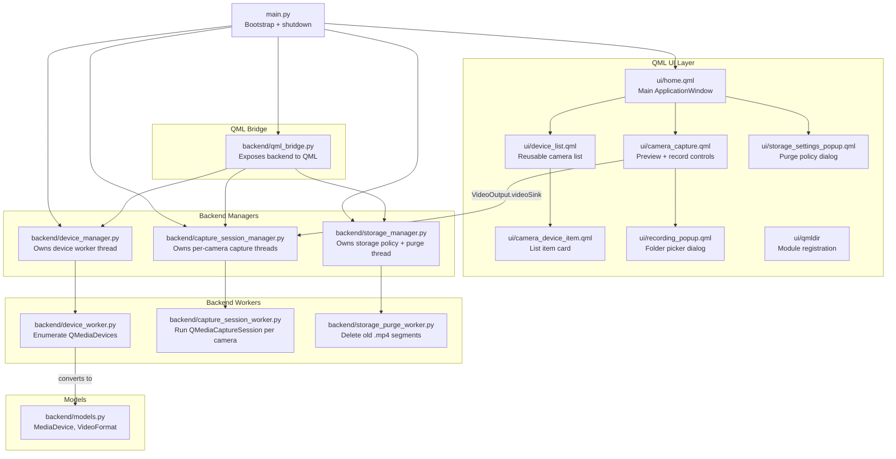

# Watchtower

<p align="center">
  
</p>

Watchtower is a cross-platform desktop application built with PySide6 / Qt6 QML for discovering, previewing, and continuously recording from locally attached USB cameras. It enumerates available video capture devices, lets users preview any camera in real time, and records H.264/MPEG-4 video in rolling 15-minute segments. Watchtower automatically purges older recordings based on configurable retention and free-space policies.

---

## Tech Stack

- **PySide6 >= 6.12.0** — Qt for Python bindings (GUI, multimedia, settings).
- **Qt Multimedia** — `QMediaDevices`, `QCamera`, `QMediaCaptureSession`, `QMediaRecorder`.
- **QML** — Declarative UI (`ui/`).
- **Pydantic >= 2.0.0** — Data models for camera devices and video formats.
- **PyInstaller** — Windows executable packaging.
- **pytest + pytest-qt** — Unit and Qt integration tests.

---

## Architecture Overview

The application is split into three layers:

1. **QML UI Layer** (`ui/*.qml`) — The user interface.
2. **QML Bridge** (`backend/qml_bridge.py`) — Adapts backend objects/signals/slots so they are accessible from QML.
3. **Backend Layer** (`backend/*.py`) — Managers, workers, and data models that interact with Qt Multimedia and the filesystem.



---

## File Reference

### Entry Point

- **`main.py`**
  - Bootstraps the Qt application (`QGuiApplication` + `QQmlApplicationEngine`).
  - Instantiates `DeviceManager`, `StorageManager`, and `CaptureSessionManager`.
  - Creates `QmlBridge` and exposes it to QML as the context property `bridge`.
  - Loads the `ui/home` QML module and connects shutdown cleanup for all background threads.

### QML Bridge

- **`backend/qml_bridge.py`**
  - A single `QObject` that adapts the three backend managers for QML consumption.
  - Forwards signals such as `videoInputsChanged`, `errorOccurred`, `storagePolicyChanged`, and `storageCritical`.
  - Exposes properties including `videoInputs`, `lastRefreshTime`, `captureManager`, `storageManager`, storage policy values, and disk-usage status.
  - Provides QML-callable slots: `refreshDevices`, `saveStoragePolicy`, `loadStoragePolicy`, `triggerPurgeNow`, `setPurgeActiveOnly`, and managed-folder edits.

### Backend Managers

- **`backend/device_manager.py`**
  - Owns a dedicated `QThread` running a `DeviceWorker`.
  - Caches the list of `MediaDevice` models and the last successful refresh timestamp.
  - Emits `videoInputsChanged`, `lastRefreshTimeChanged`, and `errorOccurred`.
  - Provides `find_camera_device()` so the main thread can resolve a `device_id` back to a `QCameraDevice`.
  - Wires graceful worker shutdown on app exit.

- **`backend/capture_session_manager.py`**
  - Spawns and owns one `CaptureSessionWorker` per detected camera, each on its own `QThread`.
  - Receives `QVideoSink` objects from QML `VideoOutput` and routes them to the correct worker.
  - Tracks the currently selected camera (`currentDeviceId`, `cameraActive`).
  - Handles start/stop recording commands, normalizes folder paths, checks free space via `StorageManager`, and registers recording folders with `StorageManager`.
  - Stops all recording if `StorageManager` emits `storageCritical`.
  - Emits `sessionStarted`, `sessionStopped`, `deviceRecordingStateChanged`, and `segmentFinalized`.

- **`backend/storage_manager.py`**
  - Owns the storage purge policy and persists it through `QSettings`.
  - Runs `StoragePurgeWorker` on a background `QThread` with a configurable timer.
  - Refreshes disk-usage status every 5 seconds and exposes `storageStatusText`, `storageUsageRatio`, and `freeSpaceGb`.
  - Tracks active recording folders and protected (currently writing) files from `CaptureSessionManager`.
  - Emits `policyChanged`, `storageStatusChanged`, and `storageCritical`.

### Backend Workers

- **`backend/device_worker.py`**
  - Lives on the device-manager thread.
  - Instantiates `QMediaDevices` on that thread to avoid blocking the GUI during USB enumeration.
  - Converts native `QCameraDevice` / `QCameraFormat` objects into Pydantic `MediaDevice` / `VideoFormat` models.
  - Emits `devicesChanged` with the model list and a UTC timestamp, or `errorOccurred` on failure.

- **`backend/capture_session_worker.py`**
  - One instance per camera, running on its own `QThread`.
  - Builds a `QMediaCaptureSession`, `QCamera`, and `QMediaRecorder` on the worker thread.
  - Attaches the `QVideoSink` supplied by QML so the live preview is rendered.
  - Configures the recorder for H.264/MPEG4 at the camera's best resolution/frame rate.
  - Records 15-minute segments, auto-rotating when each segment ends.
  - Emits `sessionReady`, `recordingStateChanged`, `segmentStarted`, and `segmentFinalized`.

- **`backend/storage_purge_worker.py`**
  - Lives on the storage-manager thread.
  - Runs a `QTimer` based on the configured purge interval.
  - Scans active and/or managed folders for finalized `.mp4` files.
  - Deletes files older than the retention age, then deletes oldest files until the minimum free-space threshold is met.
  - Skips files listed as protected (currently being written by an active recording).
  - Emits `purgedFiles` or `purgeFailed`.

### Data Models

- **`backend/models.py`**
  - Defines Pydantic models for the camera data flowing from the backend to the UI.
  - `VideoFormat` — resolution, dimensions, frame-rate range, and pixel format.
  - `MediaDevice` — device ID, description, default flag, photo resolutions, and supported video formats.

### QML UI

- **`ui/home.qml`**
  - Main `ApplicationWindow` containing the toolbar, device list, capture preview stack, and error/status area.
  - Binds to `bridge.videoInputs`, `bridge.lastRefreshTime`, and `bridge.captureManager.currentDeviceId`.
  - Displays errors from both the device bridge and the capture manager.

- **`ui/device_list.qml`**
  - Reusable scrollable list component.
  - Accepts a `devices` array and a `selectedDeviceId`.
  - Emits `deviceSelected(deviceId)` when the user clicks a camera.

- **`ui/camera_device_item.qml`**
  - Visual card rendered for each camera in the list.
  - Shows description, default indicator, device ID, photo resolution, and available video formats.
  - Highlights when selected.

- **`ui/camera_capture.qml`**
  - Right-hand preview panel for the selected camera.
  - Uses `VideoOutput` to display the live feed and registers its `videoSink` with `CaptureSessionManager`.
  - Shows Record / Stop Recording controls and a red recording indicator.
  - Opens `RecordingPopup` to choose the output folder.

- **`ui/recording_popup.qml`**
  - Modal popup that lets the user pick an output folder via a native `FolderDialog`.
  - Emits `startRecording(folderPath)` to the parent `CameraCapture`.

- **`ui/storage_settings_popup.qml`**
  - Modal popup for configuring minimum free space, maximum retention age, purge interval, and managed folders.
  - Reads from and writes to `bridge` storage properties/slots.
  - Shows a disk-usage progress bar and status text.

- **`ui/qmldir`**
  - Registers the `ui` QML module and maps public component names (`DeviceList`, `CameraCapture`, etc.) to their source files.

---

## Running / Building

Run from the project root with `uv` or your preferred Python environment:

```bash
uv run python main.py
```

Run tests:

```bash
uv run pytest
```

Build a standalone executable with PyInstaller:

```bash
uv run pyinstaller watchtower.spec
```

The spec file (`watchtower.spec`) and `pyproject.toml` configure the PyInstaller bundle.
