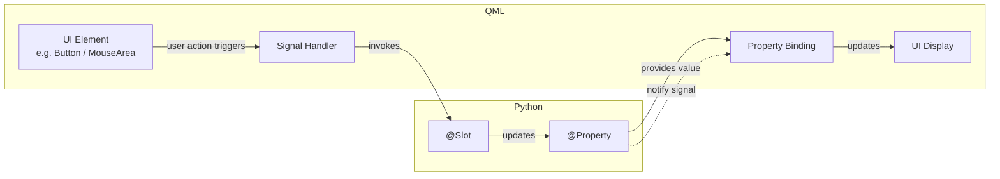
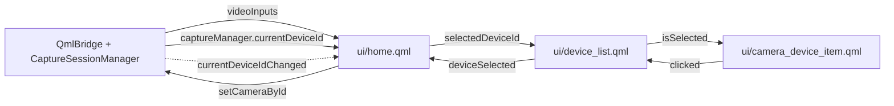

# Learnings

Here are some key learnings from building this application

## USB Device Basics

- USB devices expose a hierarchy: **Device → Configuration → Interface → Endpoint**.
- A **device** is the physical gadget; a **configuration** is a collection of interfaces and power settings.
- An **interface** represents a logical function such as audio, HID, mass storage, or video.
- Interfaces are identified by `bInterfaceClass`, a 1-byte hexadecimal field:
  - `0x01` — Audio
  - `0x03` — Human Interface Device (HID)
  - `0x08` — Mass Storage
  - `0x0E` — Video
- **Endpoints** are the actual data pipes and live inside interfaces.
- PyUSB can enumerate devices and inspect descriptors, but it only identifies that a device is video-class, it does not provide a capture handle suitable for higher-level frameworks.

## Camera APIs on Windows

- **OpenCV**
  - Considered for video capture and preview.
  - Did not provide reliable device enumeration or a stable way to select a specific camera by identity.
- **PyUSB**
  - Allowed reading USB descriptors and filtering for video-class devices.
  - Did not expose the information needed to open the device in OpenCV.
- **DirectShow via COM (`comtypes`)**
  - Explored the System Device Enumerator and filter graphs.
  - Required manual COM initialization, moniker binding, and property-bag access.
  - Ran into issues providing the enumerator with the expected `ICreateDevEnum` interface when using `pywin32`.
- **Windows Media Foundation**
  - The modern Microsoft-recommended replacement for DirectShow.
  - More accessible than DirectShow but still lower-level than necessary for this project.

## QT for Python as the Simpler Path

QT for Python (PySide6) provides the GUI and platform agnostic multimedia stack in one framework.
- `QMediaDevices` lists available cameras without platform-specific code.
- `QCameraDevice` represents each camera and includes a stable `id`.
- `QMediaCaptureSession` wires camera input to outputs such as viewfinder, recorder, or image capture.
- `QMediaRecorder` handles file output, codecs, resolution, frame rate, and recording state.
- This removed the need to interact directly with COM, DirectShow, or Media Foundation.

QT Threads
- Camera recording and storage operations (such as writing video segments and purging old files) are moved off the main GUI thread because they are I/O-bound and would block or freeze the UI if run synchronously.
- Each camera runs in its own worker thread via CaptureSessionWorker, managed by CaptureSessionManager, so the main thread stays responsive to user input and QML rendering.
- Storage maintenance runs on a separate worker (StoragePurgeWorker) so long-running purge jobs do not stall the interface.
- Worker thread cleanup uses a safe shutdown pattern: quit → wait → terminate if needed → deleteLater.

## QML ↔ Python Integration

The UI is built in **QML** while the business logic lives in **Python `QObject` subclasses** exposed to QML as `bridge`. 
- Python methods callable from QML are marked with `@Slot()`
- Python state variables are exposed via `@Property(type, notify=signal)` so QML bindings react automatically when values change via signal/ events

This creates a clear two-way pattern:

- **Reading State**: QML uses property bindings to read values exposed by Python `@Property`.
- **Sending Actions**: QML emits signals that then invoke Python `@Slot()` methods from the UI
- **Updating the UI/ Closing the Loop**
    - When a `@Slot` function runs, it will changes a `@Property`, the notify signal on the `@Property` will let QML know to re-trigger the binding and refresh the UI.

## Integration Example - Selecting Device from Device List

### Full end-to-end flow

1. `home.qml` renders `DeviceList` and passes `bridge.videoInputs` as `devices`.
2. `DeviceList.selectedDeviceId` is bound to `bridge.captureManager.currentDeviceId`.
3. `device_list.qml` creates a `CameraDeviceItem` for each device and sets `isSelected` by comparing `modelData.deviceId` with `selectedDeviceId`.
4. `camera_device_item.qml` shows the device description, ID, and formats, and highlights itself when `isSelected` is true.
5. The user clicks an item. The item's `MouseArea` calls `root.clicked()`, emitting `CameraDeviceItem.clicked()`.
6. `device_list.qml` receives `onClicked` and re-emits `root.deviceSelected(modelData.deviceId)`.
7. `home.qml` receives `onDeviceSelected` and calls `bridge.captureManager.setCameraById(deviceId)`.
8. The Python backend updates `_current_device_id` and emits `currentDeviceIdChanged`.
9. The binding in `home.qml` re-evaluates, updating `DeviceList.selectedDeviceId` and re-highlighting the newly selected item.

### Flow diagram

### Summary

- **Downward:** `CaptureSessionManager.currentDeviceId` → `DeviceList.selectedDeviceId` → each `CameraDeviceItem.isSelected`.
- **Upward:** `CameraDeviceItem.clicked()` → `DeviceList.deviceSelected(deviceId)` → `home.qml` → `CaptureSessionManager.setCameraById(deviceId)`.
- **Loop closes:** `setCameraById` updates `currentDeviceId`, emits `currentDeviceIdChanged`, and the downward binding re-highlights the selected item.
